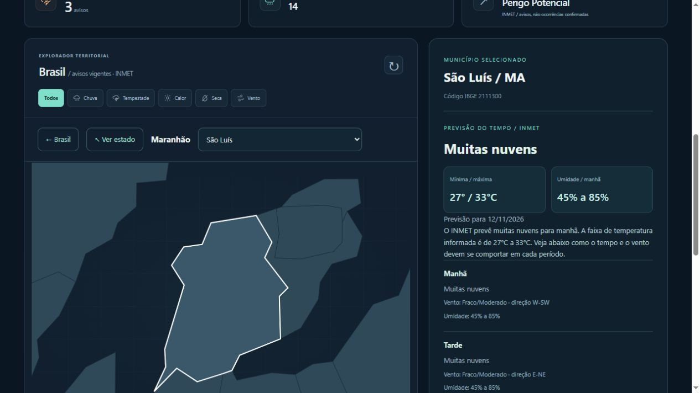

# Zeeclima — monitoramento meteorológico e contexto ENSO

Projeto demonstrativo autoral da Zeefher Labs, desenvolvido com assistência de IA. Reúne dados públicos oficiais e uma simulação interativa em modos distintos.

## Demonstração e código

[Demonstração online](https://zeefher-portfolio.vercel.app/zeeclima/) · [Portfólio](https://zeefher-portfolio.vercel.app/) · [Código](https://github.com/zeefher/zeefher-labs/tree/main/zeeclima)

## Problema e solução

Informações meteorológicas distribuídas em diferentes fontes exigem contexto e uma navegação clara. O Zeeclima reúne exploração territorial, previsão municipal, avisos e contexto ENSO, identificando origem, validade e limitações. A interface oferece Brasil → estado → município com zoom suave e alternativa de seleção por lista, inclusive no celular.

## Executar localmente

Clone o repositório zeefher-labs e execute na raiz:

    python dev.py

Abra http://127.0.0.1:8000/zeeclima/. Use Python 3.12 ou superior. Não há novas dependências, chaves nem APIs pagas. As fontes públicas requerem conexão à internet.

## Arquitetura

HTML, CSS e JavaScript sem framework no frontend; SVG com malhas reais IBGE; Python com biblioteca padrão no backend. A função api/zeeclima.py aceita apenas recursos predefinidos. Código municipal e UF são validados; não há proxy de URLs arbitrárias, geolocalização pessoal ou coleta de dados de visitantes.

## Modo oficial

- Consulta avisos ativos do INMET e filtra início e fim pela validade publicada, no horário de Brasília.
- Desenha os polígonos reais dos avisos, sobre a malha simplificada do IBGE.
- O resumo por UF é agregado: um aviso em parte do estado não significa que o estado inteiro está afetado.
- Exibe severidade, período, referência original e data da consulta.
- Nenhum aviso encontrado não significa ausência de risco. Falha de consulta é exibida como indisponibilidade, sem gerar dados fictícios.
- Avisos descrevem condições previstas, não confirmam eventos observados.

Fonte INMET consultada: https://apiprevmet3.inmet.gov.br/avisos/ativos
Consulta pública oficial: https://avisos.inmet.gov.br/

O endpoint JSON não tem contrato versionado garantido; formatos desconhecidos são tratados como erro e exigem manutenção do adaptador.

## Contexto El Niño / La Niña

- Comunicado ENSO oficial NOAA CPC, com a data de publicação.
- RONI trimestral, ERSSTv6: valores recentes sujeitos a revisão.
- Série mensal de anomalias relativas Niño 3.4, explicitamente distinta do RONI.
- Contexto sazonal regional de referência baseado no boletim do Painel El Niño publicado pelo Cemaden em 29/10/2026, para nov/2026–jan/2027. Este texto é uma referência editorial datada, não uma previsão automática e nem um feed continuamente atualizado. Após o período, a interface o identifica como histórico.
- Não atribui automaticamente chuva, seca ou outros eventos locais ao ENSO. Não estima porcentagem de danos.

Fontes NOAA:
https://www.cpc.ncep.noaa.gov/products/analysis_monitoring/enso_advisory/ensodisc.shtml
https://www.cpc.ncep.noaa.gov/products/analysis_monitoring/enso/roni/
https://www.cpc.ncep.noaa.gov/data/indices/rel_mthsst9120.txt

Referência regional:
https://www.gov.br/cemaden/pt-br/assuntos/monitoramento/el-nino/boletim-do-painel-el-nino-ndeg-05-outubro-de-2026-potenciais-impactos-e-orientacoes

## Frequência e falhas

O navegador consulta o servidor a cada 5 minutos quando a aba está visível. O servidor mantém cache de 10 minutos para INMET e 6 horas para NOAA; isso não muda a periodicidade semanal/mensal da publicação das fontes. Não é atualização em segundos. A data real de consulta é exibida.

Em falhas, o servidor preserva a última consulta em memória com status stale, quando disponível, e tenta novamente após 2 minutos. Sem uma consulta anterior, informa indisponibilidade. O cache não persiste ao reiniciar. Avisos vencidos são removidos pelo horário no navegador também.

## Modo simulado

Mapa por UF com intensidade fictícia em quatro faixas; filtros por chuva, tempestade, calor, seca e vento; cenários de 24/48/72 horas; gráfico fictício de probabilidade de ocorrência; lista de eventos. Os números não são previsões, estimativas de danos ou modelos meteorológicos validados. O painel ENSO permanece oficial e separado do cenário local fictício.

## Geometria

Malha simplificada do IBGE obtida em 12/11/2026:
https://servicodados.ibge.gov.br/api/v3/malhas/paises/BR?formato=application/vnd.geo%2Bjson&intrarregiao=UF&qualidade=minima

O GeoJSON original fica em brasil-ibge.geojson. preparar_mapa.py documenta a geração original do mapa.js com projeção equiretangular simplificada, inadequada a medições cartográficas. As áreas de aviso são projetadas com a mesma transformação.

## Verificação

    python -m unittest zeeclima.test_servidor tests.test_zeeclima

Testes cobrem validade dos avisos, deduplicação, geocódigos, formatos inválidos e distinção entre RONI e série mensal. A revisão no navegador cobre seleção de UF, filtros, períodos e separação dos modos. Evidências em verificacao/.

A captura é um retrato datado da interface, não um aviso meteorológico atual. Consulte sempre a vigência no site e na fonte original.

## Exploração municipal
Clique em um estado para abrir seus municípios (malha e nomes IBGE oficiais, com cópia estática datada em municipios/; carregamento sob demanda). Selecione uma cidade pelo mapa ou pela lista. Os avisos são associados pelo código municipal publicado pelo INMET, sem interpolação de risco. No modo simulado, os indicadores permanecem estaduais. Use “Brasil” para voltar. Requer servidor.py e conexão às fontes públicas.

## Zoom e previsão municipal
Ao selecionar um município, o SVG aproxima seus limites com transição suave (respeita movimento reduzido). “Ver estado” restaura a visão municipal completa. O painel lateral mostra previsão municipal INMET por turno e próximos dias, com mínima/máxima, umidade, descrição e vento qualitativo. São previsões, não observações ao vivo. A API não fornece neste retorno probabilidade de danos nem volume de precipitação. O servidor consulta /previsao/{codigoIBGE} sob demanda e mantém cache de 15 minutos, preservando consulta anterior identificada em falhas. Não usa Open-Meteo nem serviços pagos.

## Hospedagem
A Vercel executa api/zeeclima.py e serve os arquivos estáticos. O cache em memória é oportunista por instância, não compartilhado nem persistente; os prazos não garantem sincronização entre instâncias. Falhas são identificadas, sem preencher lacunas com dados fictícios. A origem dos dados e a ausência de um modelo meteorológico próprio devem ser preservadas em apresentações e materiais de divulgação.

As malhas municipais das 27 UFs foram obtidas diretamente do IBGE em 12/11/2026 e acompanham a publicação. São limites administrativos simplificados, não imagens de satélite nem medições do tempo. O campo fetched_at registra a obtenção. Sua atualização exige nova obtenção do IBGE; previsões e avisos permanecem dinâmicos.
